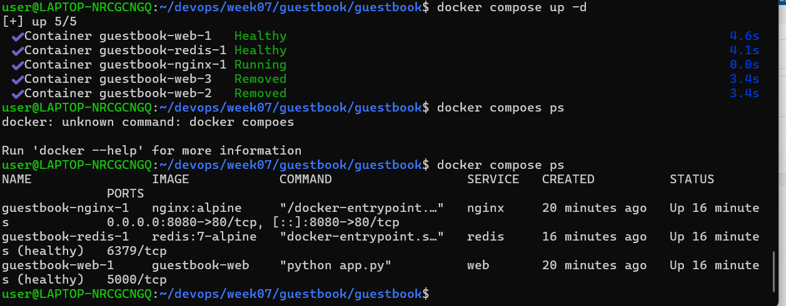
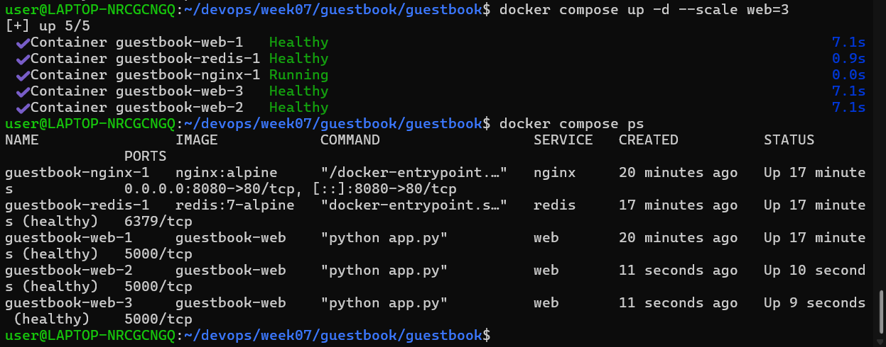
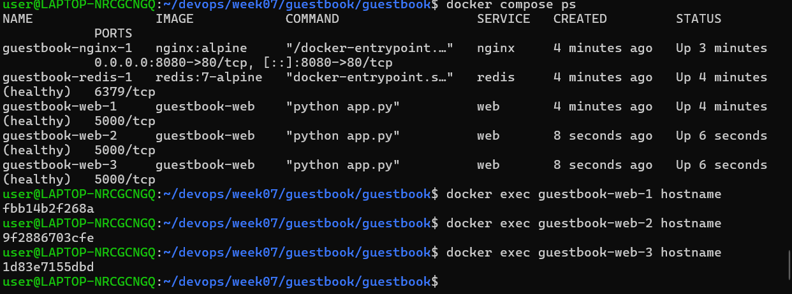

## Docker Compose 실행 결과

## Web Scale 결과

## 각 Web 컨테이너 hostname 확인

## down과 down -v 차이

### docker compose down
- 컨테이너와 네트워크는 삭제된다.
- 볼륨은 유지된다.
- 다시 실행해도 Redis에 저장된 방명록 데이터가 남아있다.

### docker compose down -v
- 컨테이너와 네트워크뿐만 아니라 볼륨도 삭제된다.
- Redis 데이터도 삭제되어 방명록 글이 사라진다.

## .env를 Git에 올리지 않는 이유

.env 파일에는 비밀번호 같은 중요한 환경 변수가 들어갈 수 있다.
GitHub에 올리면 비밀번호가 외부에 노출될 수 있기 때문에
.gitignore에 등록하여 Git에 포함하지 않는다.
